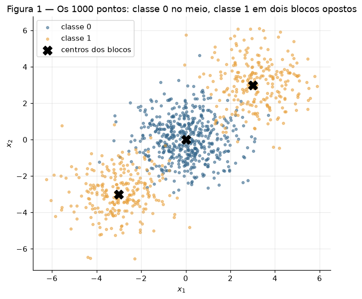
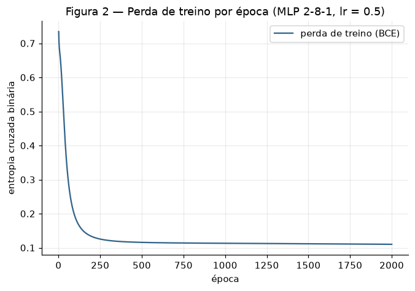
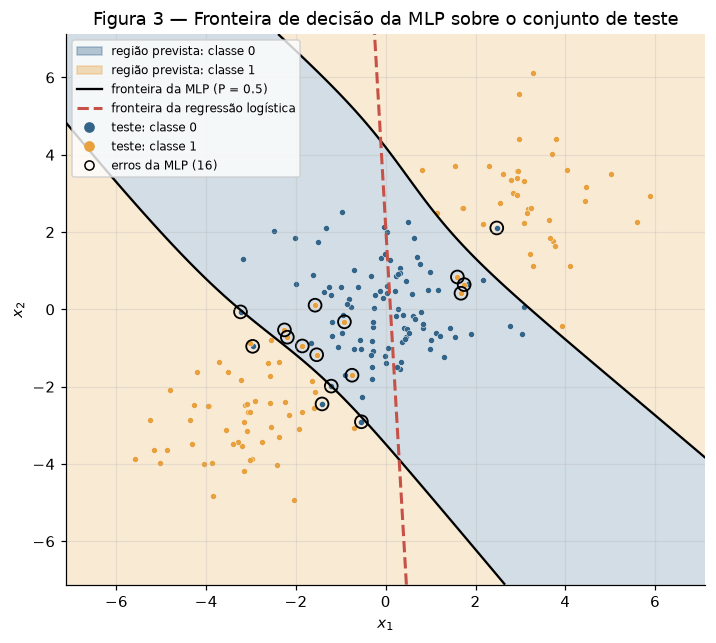
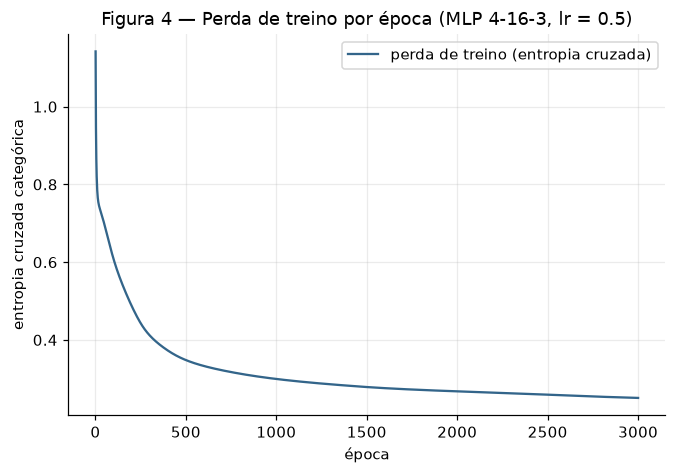
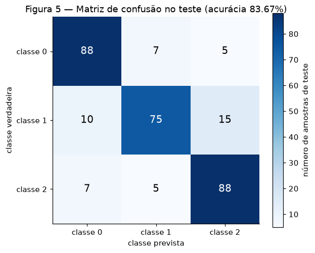
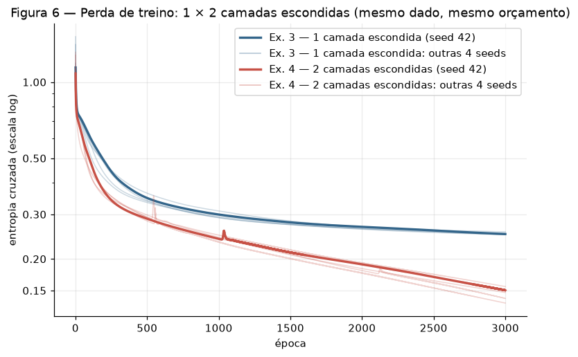

# Exercício — MLP

!!! abstract "Sobre esta entrega"

    Atividade individual sobre perceptrons multicamadas
    ([enunciado](https://insper.github.io/ann-dl/2026.2/exercises/mlp/){:target="_blank"}).
    O fio condutor é **o que uma camada escondida compra**: um passo de backpropagation à mão,
    um dataset que nenhuma reta separa, mais classes e, por fim, a pergunta se uma *segunda*
    camada compra alguma coisa.

    **Código** em [`code/`](https://github.com/Lagoass/ann-dl/tree/main/docs/exercises/mlp/code){:target="_blank"}:
    `mlp.py` (a rede, escrita uma vez), `dados.py` (geração e split), `check_gradients.py`
    e um script por exercício. **Figuras** em `figures/`. A saída completa de todos os
    scripts está em [`code/saida.txt`](https://github.com/Lagoass/ann-dl/blob/main/docs/exercises/mlp/code/saida.txt){:target="_blank"}.
    O passo a passo do meu raciocínio está em [Raciocínio — MLP](../../raciocinio/mlp.md).

!!! note "Uso de IA"

    Usei Claude (Claude Code) como par de programação, seguindo um plano por etapas que
    defini antes do código. A MLP — ativações, perdas, forward, backward e update — é escrita
    à mão em `numpy`, sem PyTorch, TensorFlow ou `MLPClassifier`. O Exercício 1 foi deduzido
    à mão e só conferido por código. Revisei e sei explicar cada parte. A mesma declaração
    está no front matter (`ai_use`).

!!! note "Reprodutibilidade e decisões comuns aos exercícios"

    - **Seeds.** Cada script cria `rng = np.random.default_rng(42)`, que inicializa os pesos,
      e assim roda sozinho e reproduz seus números. Os geradores do scikit-learn usam
      `random_state=42`, como o enunciado especifica. O Exercício 4 pede pelo menos 3 seeds;
      usei 5 (42 a 46).
    - **scikit-learn só onde o enunciado deixa:** `make_blobs`, `make_classification`,
      `train_test_split`, `confusion_matrix` e a `LogisticRegression` dos dois baselines.
    - **Padronização das entradas** com média e desvio do **treino**, feita em `numpy`
      (o scikit-learn não pode fazer isso aqui). A `tanh` satura com entradas grandes, e
      calcular as estatísticas só no treino evita vazamento.
    - **Treino:** descida do gradiente em lote completo, inicialização de Glorot,
      `tanh` nas camadas escondidas. Escolhi os hiperparâmetros olhando **só a perda de
      treino**, nunca a acurácia de teste.

    ``` shell
    pip install -r requirements.txt
    cd docs/exercises/mlp/code
    python check_gradients.py && python ex1_backprop.py && python ex2_binary.py
    python ex3_multiclass.py && python ex4_depth.py
    ```

## Exercise 1 — One Step of Backpropagation, by Hand

Rede 2-2-1 com $\tanh$ nas duas camadas e perda $L = (y - \hat y)^2$ (um único exemplo,
$N = 1$). Dados: $\mathbf{x} = [0.5,\ -0.2]$, $y = 1$,
$\mathbf{W}^{(1)} = \begin{bmatrix} 0.3 & -0.1 \\ 0.2 & 0.4 \end{bmatrix}$,
$\mathbf{b}^{(1)} = [0.1,\ -0.2]$, $\mathbf{W}^{(2)} = [0.5,\ -0.3]$, $b^{(2)} = 0.2$ e
$\eta = 0.3$. As contas usam precisão completa e são exibidas com 6 casas.

### A — Forward pass

**Pré-ativações escondidas**, $\mathbf{z}^{(1)} = \mathbf{W}^{(1)}\mathbf{x} + \mathbf{b}^{(1)}$:

$$
\begin{aligned}
z^{(1)}_1 &= 0.3(0.5) + (-0.1)(-0.2) + 0.1 = 0.150000 + 0.020000 + 0.100000 = \mathbf{0.270000} \\
z^{(1)}_2 &= 0.2(0.5) + 0.4(-0.2) - 0.2 = 0.100000 - 0.080000 - 0.200000 = \mathbf{-0.180000}
\end{aligned}
$$

**Ativações escondidas**, $\mathbf{h}^{(1)} = \tanh(\mathbf{z}^{(1)})$:
$h^{(1)}_1 = \tanh(0.27) = \mathbf{0.263625}$ e $h^{(1)}_2 = \tanh(-0.18) = \mathbf{-0.178081}$.

**Pré-ativação da saída**, $u^{(2)} = \mathbf{W}^{(2)}\mathbf{h}^{(1)} + b^{(2)}$:

$$
u^{(2)} = 0.5(0.263625) + (-0.3)(-0.178081) + 0.2 = 0.131812 + 0.053424 + 0.200000 = \mathbf{0.385237}
$$

**Saída e perda:** $\hat y = \tanh(0.385237) = \mathbf{0.367247}$ e
$L = (1 - 0.367247)^2 = 0.632753^2 = \mathbf{0.400377}$.

### B — Backward pass

Cada derivada vem da regra da cadeia, de trás para frente.

**1. Perda em relação à saída.** $L = (y - \hat y)^2$, então

$$
\frac{\partial L}{\partial \hat y} = -2(y - \hat y) = -2(0.632753) = \mathbf{-1.265507}
$$

**2. Pela $\tanh$ da saída.** $\hat y = \tanh(u^{(2)})$ e $\frac{d}{du}\tanh(u) = 1 - \tanh^2(u) = 1 - \hat y^2$:

$$
\frac{\partial L}{\partial u^{(2)}} = \frac{\partial L}{\partial \hat y}\,(1 - \hat y^2)
= -1.265507 \times (1 - 0.134870) = -1.265507 \times 0.865130 = \mathbf{-1.094828}
$$

**3. Parâmetros da saída.** Como $u^{(2)} = \sum_j W^{(2)}_j h^{(1)}_j + b^{(2)}$, temos
$\partial u^{(2)}/\partial W^{(2)}_j = h^{(1)}_j$ e $\partial u^{(2)}/\partial b^{(2)} = 1$:

$$
\frac{\partial L}{\partial \mathbf{W}^{(2)}} = \frac{\partial L}{\partial u^{(2)}}\,\mathbf{h}^{(1)}
= -1.094828 \times [0.263625,\ -0.178081] = \mathbf{[-0.288624,\ 0.194968]},
\qquad
\frac{\partial L}{\partial b^{(2)}} = \mathbf{-1.094828}
$$

**4. De volta às ativações escondidas.** $\partial u^{(2)}/\partial h^{(1)}_j = W^{(2)}_j$:

$$
\frac{\partial L}{\partial \mathbf{h}^{(1)}} = \frac{\partial L}{\partial u^{(2)}}\,\mathbf{W}^{(2)}
= -1.094828 \times [0.5,\ -0.3] = \mathbf{[-0.547414,\ 0.328448]}
$$

**5. Pela $\tanh$ escondida**, elemento a elemento, com $1 - (\mathbf{h}^{(1)})^2 = [1 - 0.069498,\ 1 - 0.031713] = [0.930502,\ 0.968287]$:

$$
\frac{\partial L}{\partial \mathbf{z}^{(1)}} = \frac{\partial L}{\partial \mathbf{h}^{(1)}} \odot \big(1 - (\mathbf{h}^{(1)})^2\big)
= [-0.547414 \times 0.930502,\ 0.328448 \times 0.968287] = \mathbf{[-0.509370,\ 0.318032]}
$$

**6. Parâmetros escondidos.** $z^{(1)}_i = \sum_j W^{(1)}_{ij} x_j + b^{(1)}_i$, então
$\partial z^{(1)}_i / \partial W^{(1)}_{ij} = x_j$ e $\partial z^{(1)}_i / \partial b^{(1)}_i = 1$.
Logo o gradiente de $\mathbf{W}^{(1)}$ é o produto externo
$\frac{\partial L}{\partial \mathbf{z}^{(1)}}\,\mathbf{x}^\top$, e o de $\mathbf{b}^{(1)}$ é o
próprio $\frac{\partial L}{\partial \mathbf{z}^{(1)}}$.

$$
\frac{\partial L}{\partial \mathbf{W}^{(1)}} =
\begin{bmatrix} -0.509370 \times 0.5 & -0.509370 \times (-0.2) \\ 0.318032 \times 0.5 & 0.318032 \times (-0.2) \end{bmatrix}
= \mathbf{\begin{bmatrix} -0.254685 & 0.101874 \\ 0.159016 & -0.063606 \end{bmatrix}},
\qquad
\frac{\partial L}{\partial \mathbf{b}^{(1)}} = \mathbf{[-0.509370,\ 0.318032]}
$$

### C — Parameter update

Com $\theta \leftarrow \theta - \eta\,\partial L/\partial\theta$ e $\eta = 0.3$:

| Parâmetro | Antes | $-\eta \times$ gradiente | Depois |
|---|---|---|---|
| $W^{(2)}_1$ | 0.5 | +0.086587 | **0.586587** |
| $W^{(2)}_2$ | −0.3 | −0.058490 | **−0.358490** |
| $b^{(2)}$ | 0.2 | +0.328448 | **0.528448** |
| $W^{(1)}_{11}$ | 0.3 | +0.076405 | **0.376405** |
| $W^{(1)}_{12}$ | −0.1 | −0.030562 | **−0.130562** |
| $W^{(1)}_{21}$ | 0.2 | −0.047705 | **0.152295** |
| $W^{(1)}_{22}$ | 0.4 | +0.019082 | **0.419082** |
| $b^{(1)}_1$ | 0.1 | +0.152811 | **0.252811** |
| $b^{(1)}_2$ | −0.2 | −0.095410 | **−0.295410** |

O enunciado fala em oito parâmetros, mas a rede 2-2-1 tem **nove** valores escalares
(4 + 2 + 2 + 1). Atualizei todos.

**A perda cai numa segunda passada.** Com os parâmetros novos, $\hat y = 0.711181$ e
$L = 0.083417$: uma queda de **0.316960**. O motivo é que o passo vai na direção oposta ao
gradiente. Pela aproximação de primeira ordem,
$\Delta L \approx \nabla L^\top \Delta\theta = -\eta\,\lVert \nabla L \rVert^2 = -0.3 \times 1.785141 = -0.535542 < 0$:
para um passo pequeno o bastante na direção de $-\nabla L$, a perda sempre diminui. A queda
real (−0.316960) é menor que a prevista (−0.535542) porque $L$ não é linear: a previsão
linear daria $0.400377 - 0.535542 < 0$, o que é impossível, já que $L \ge 0$. A curvatura
pesa: $\hat y$ se aproxima de 1, a $\tanh$ satura e o ganho de cada passo encolhe. Aqui nem
um $\eta$ maior faria a perda subir: como $y = 1$ e $\hat y = \tanh(u) < 1$, a saída nunca
passa do alvo, e ao longo de $-\nabla L$ a perda cai para qualquer $\eta > 0$. Em geral,
porém, um $\eta$ grande demais pode fazer o passo passar do mínimo e *aumentar* a perda.

**Conferência por código.** O script abaixo refaz a conta com as fórmulas explícitas e depois
roda a mesma rede pela classe genérica de `mlp.py` (com a perda `MSETanh`). A maior
diferença entre os gradientes da conta à mão e os do código genérico é **0.00e+00**.

??? example "Código — `ex1_backprop.py` (conferência da conta à mão)"

    ``` { .python .copy linenums="1" title="docs/exercises/mlp/code/ex1_backprop.py" }
    --8<-- "docs/exercises/mlp/code/ex1_backprop.py"
    ```

## Exercise 2 — Binary Classification a Straight Line Cannot Do

### A — Generate the data

Com os parâmetros do enunciado, sem alteração: 1000 pontos, sendo 500 da classe 0 num bloco
em $(0, 0)$ e 500 da classe 1 divididos em dois blocos, em $(3, 3)$ e $(-3, -3)$, todos com
desvio 1.2. O split 80/20 estratificado com `random_state=42` deixa **800 pontos no treino
(400 + 400) e 200 no teste (100 + 100)**.



??? example "Código — `dados.py` (geração e split dos Exercícios 2 a 4)"

    ``` { .python .copy linenums="1" title="docs/exercises/mlp/code/dados.py" }
    --8<-- "docs/exercises/mlp/code/dados.py"
    ```

### B — Establish the baseline

Uma regressão logística ajustada no treino acerta **47.50%** no teste, abaixo do chute.
Guardo esse número para o item D.

### C — Implement the MLP

A rede está em `mlp.py`: uma classe que recebe os tamanhos das camadas como argumento
(`[2, 8, 1]` aqui, qualquer profundidade em geral). Ela implementa à mão o forward, as
perdas, o backward (cada gradiente derivado, nada de autodiff) e o update. A decisão de
design central é que **cada perda devolve $\partial L/\partial u$ na pré-ativação da
saída** (ver 3B). Com isso, forward, backward e update são o mesmo código para qualquer
perda.

``` { .python .copy linenums="1" title="docs/exercises/mlp/code/mlp.py" }
--8<-- "docs/exercises/mlp/code/mlp.py"
```

**Antes de treinar, provei que o backward está certo.** `check_gradients.py` compara cada
gradiente com diferenças finitas centradas, $[L(\theta+\varepsilon) - L(\theta-\varepsilon)]/2\varepsilon$,
em 5 redes (com as três perdas e até 3 camadas escondidas). O pior erro relativo foi
**1.05e-07**, e o maior erro absoluto, 1.24e-10. Uma derivada errada daria erro da ordem
de 1.

??? example "Código — `check_gradients.py`"

    ``` { .python .copy linenums="1" title="docs/exercises/mlp/code/check_gradients.py" }
    --8<-- "docs/exercises/mlp/code/check_gradients.py"
    ```

**Arquitetura e treino:**

- Rede **2-8-1** (33 parâmetros): `tanh` na camada escondida, sigmoide na saída e entropia
  cruzada binária.
- **Learning rate 0.5** e **2000 épocas** em lote completo. Comparei com 0.1, partindo da
  mesma inicialização. Nas épocas 500, 1000 e 2000, a perda com 0.1 vale 0.1883, 0.1327 e
  0.1174, e ainda cai. Com 0.5 vale 0.1157, 0.1130 e 0.1101: já está em platô.
- A perda de treino vai de 0.7344 a **0.1101**.
- **Acurácia de teste: 92.00%** (treino: 96.37%).





??? example "Código — `ex2_binary.py`"

    ``` { .python .copy linenums="1" title="docs/exercises/mlp/code/ex2_binary.py" }
    --8<-- "docs/exercises/mlp/code/ex2_binary.py"
    ```

### D — Analysis

**A forma da região da classe 1 (Figura 3).** A MLP pinta a classe 0 como uma **faixa
diagonal** que atravessa a origem, perpendicular à direção $(1, 1)$. A classe 1 fica com o
que sobra: **dois pedaços separados**, nos cantos nordeste e sudoeste. Dá para medir isso:

- Ao longo da diagonal $x_1 = x_2$, a classe prevista troca **duas vezes**, em
  $x_1 = -1.58$ e em $x_1 = 1.70$.
- Ao longo da antidiagonal $x_1 = -x_2$, que corta o meio da faixa, ela **nunca** sai da
  classe 0.

**Por que nenhuma reta produz essa região.** Uma reta divide o plano em dois semiplanos, e
um semiplano é convexo: se contém dois pontos, contém o segmento entre eles. O segmento
entre os dois blocos da classe 1, de $(3, 3)$ a $(-3, -3)$, passa por $(0, 0)$, o centro da
classe 0. Então qualquer reta precisa abrir mão de um dos blocos ou do centro da classe 0.
Como o centro tem 500 pontos e cada bloco 250, o melhor é sacrificar um bloco: no máximo
75%. A **melhor reta
possível**, encontrada por busca exaustiva no treino, faz exatamente isso: acerta 74.25% no
treino e 69.00% no teste, ficando com um bloco e o centro e sacrificando o outro bloco. Para
pintar os dois cantos são precisas pelo menos duas fronteiras, uma de cada lado da faixa — e
é isso que as unidades `tanh` da camada escondida fornecem, combinadas pela saída.

**Por que a regressão logística fica *abaixo* de 50%, e não perto dos 69% da melhor
reta.**

1. **Ela nem tenta a melhor reta.** A distribuição que gera os dados é simétrica em relação
   à origem: trocar $\mathbf{x}$ por $-\mathbf{x}$ não muda a distribuição de nenhuma das duas
   classes. Então a perda logística de $(\mathbf{w}, b)$ é igual à de $(-\mathbf{w}, b)$, e
   como a perda é convexa, com mínimo único, o mínimo fica com $\mathbf{w} \approx 0$. A
   amostra é só aproximadamente simétrica (no treino, o bloco $(3, 3)$ tem 208 pontos e o
   $(-3, -3)$ tem 192), e por isso $\mathbf{w}$ sai quase nulo, e não exatamente nulo.
2. **Os números confirmam.** Os pesos encontrados têm $\lVert\mathbf{w}\rVert = 0.0297$, e a
   probabilidade prevista nunca sai de [0.4566, 0.5438] no teste. A regressão logística
   praticamente desiste.
3. **A reta que sobra cai no lugar errado.** Com $\mathbf{w}$ quase nulo, a fronteira
   (tracejada na Figura 3) vira o sinal de flutuações minúsculas: passa quase vertical pelo
   meio, acerta **53%** da classe 0, **todo** o bloco $(3, 3)$ e **nada** do bloco
   $(-3, -3)$.
4. **O "abaixo de 50%" vem do split, não de acaso.** Cada bloco tem 250 pontos, então o
   bloco maior no treino é o menor no teste: $(3, 3)$ tem 208 contra 192 no treino e 42
   contra 58 no teste. A regressão, com $\mathbf{w}$ quase nulo, pende para o bloco
   majoritário do treino, que no teste fica em minoria: $(53 + 42 + 0)/200 = $ **47.50%**.
   Não é limite da reta: a melhor reta chega a 69.00% no teste.

A MLP chega a 92.00% porque sua fronteira tem a forma certa. Os erros que sobram estão nas
zonas onde os blocos se encostam (desvio 1.2 com centros a 4.24 de distância): 94% de
acerto no bloco central, 92.86% no bloco $(3, 3)$ e 87.93% no bloco $(-3, -3)$.

## Exercise 3 — Multi-Class, Same Network

### A — Generate the data

`make_classification` com os parâmetros do enunciado: 1500 amostras, 4 features
informativas, 3 classes e 2 clusters por classe, com `class_sep = 1.0`. O split 80/20
estratificado com `random_state=42` deixa **1200 no treino e 300 no teste** (100 por
classe).

### B — Adapt the network

A adaptação está **toda nos argumentos**: 3 unidades de saída e a perda
`CategoricalCrossEntropy`, que traz junto a softmax. O núcleo é a mesma classe do Exercício
2, importada de `mlp.py`, **sem uma linha alterada** no forward, no backward ou no update.
Entre um exercício e outro muda só a chamada:

``` python
MLP([2, 8, 1], BinaryCrossEntropy, rng)              # Exercício 2
MLP([4, 16, 3], CategoricalCrossEntropy, rng)        # Exercício 3
MLP([4, 16, 16, 3], CategoricalCrossEntropy, rng)    # Exercício 4
```

A mesma classe também reproduz a conta do Exercício 1, com a perda `MSETanh` (ver 1C).

**A derivada de softmax com entropia cruzada.** Para um exemplo com rótulo *one-hot*
$\mathbf{y}$:

$$
\hat y_k = \frac{e^{u_k}}{\sum_j e^{u_j}}, \qquad L = -\sum_k y_k \log \hat y_k .
$$

A derivada da softmax é $\dfrac{\partial \hat y_k}{\partial u_j} = \hat y_k(\delta_{kj} - \hat y_j)$,
onde $\delta_{kj}$ vale 1 se $k = j$ e 0 caso contrário. Pela regra da cadeia:

$$
\frac{\partial L}{\partial u_j}
= -\sum_k \frac{y_k}{\hat y_k}\,\frac{\partial \hat y_k}{\partial u_j}
= -\sum_k y_k(\delta_{kj} - \hat y_j)
= -y_j + \hat y_j \sum_k y_k
= \hat y_j - y_j ,
$$

usando $\sum_k y_k = 1$. O resultado é simples porque o $1/\hat y_k$ que vem do logaritmo
**cancela** o fator $\hat y_k$ do jacobiano da softmax. Sobra só o erro de previsão,
$\hat{\mathbf{y}} - \mathbf{y}$.

Duas consequências:

- **Sem fator de saturação.** No Exercício 1, com MSE, aparecia o fator $(1 - \hat y^2)$,
  que encolhe o gradiente quando a saída satura. Aqui ele não existe: uma rede confiante e
  errada recebe gradiente grande.
- **A mesma expressão vale para a sigmoide com BCE:**
  $\big[-\tfrac{y}{\hat y} + \tfrac{1-y}{1-\hat y}\big]\,\hat y(1-\hat y) = \hat y - y$.

Em lote, com a média sobre $N$ exemplos, fica $\partial L/\partial \mathbf{U} = (\hat{\mathbf{Y}} - \mathbf{Y})/N$,
que é exatamente o `grad_u` das duas perdas em `mlp.py`. É por isso que o backward do
Exercício 2 serve ao Exercício 3 sem mudança.

### C — Train and evaluate

**Arquitetura e treino:**

- Rede **4-16-3** (131 parâmetros): `tanh` + softmax e entropia cruzada categórica.
- **Learning rate 0.5** e **3000 épocas** em lote completo, escolhidos pela perda de treino:
  a partir daí ela ainda cai, mas devagar.
- A perda de treino vai de 1.1420 a **0.2508**.
- **Acurácia de teste: 83.67%** (treino: 92.00%).





??? example "Código — `ex3_multiclass.py`"

    ``` { .python .copy linenums="1" title="docs/exercises/mlp/code/ex3_multiclass.py" }
    --8<-- "docs/exercises/mlp/code/ex3_multiclass.py"
    ```

### D — Analysis

**O par mais confundido é o das classes 1 e 2.** Na Figura 5 há 15 + 5 = **20 trocas**
entre elas, contra 17 entre as classes 0 e 1 e 12 entre 0 e 2.

**A explicação pela estrutura dos 6 clusters.** O `make_classification` põe os 6 clusters em
vértices de um hipercubo 4D, com coordenadas ±1, e dá a classe $k \bmod 3$ ao cluster $k$.
Para medir essa geometria exatamente, gerei o **mesmo** dataset com `shuffle=False`. O
embaralhamento é o último passo do gerador, então os pontos são idênticos (conferi: as
normas de todas as linhas coincidem), só que agrupados por cluster. Para cada par de clusters
de classes diferentes, calculei a régua do exercício Data,
$r = \text{distância} / (\sigma_i + \sigma_j)$, com os desvios medidos ao longo do eixo que
liga os dois centroides.

| Clusters (classes) | Distância | $r$ |
|---|---|---|
| **1 e 2 (classes 1 e 2)** | 2.082 | **0.837** |
| **2 e 4 (classes 2 e 1)** | 1.917 | **0.945** |
| 0 e 1 (classes 0 e 1) | 2.032 | 0.983 |
| 3 e 5 (classes 0 e 2) | 3.031 | 1.132 |
| demais 8 pares | 2.668 a 3.946 | 1.221 a 2.795 |

O par de classes 1 e 2 é o mais sobreposto pelos dois critérios: tem o menor $r$ entre seus
clusters (**0.837**) e o menor $r$ médio (1.129, contra 1.384 do par 0 e 2 e 1.718 do par 0
e 1). O cluster 2 (classe 2) fica a um único lado do hipercubo de **dois** clusters da
classe 1 (distâncias 2.082 e 1.917), e nos dois casos $r < 1$, o que no exercício Data
significava nuvens que se atravessam. Essa leitura previa o par 1 e 2 **antes** de eu olhar
a matriz de confusão, e foi esse o par que a matriz deu, mas por pouco: 20 trocas contra 17
do par 0 e 1, uma margem que muda com a seed de inicialização. O que não muda é a estrutura:
a classe 1 está no centro da confusão, porque o cluster 1 se atravessa com um cluster da
classe 0 ($r = 0.983$) e com o cluster 2, da classe 2 ($r = 0.837$).

Há também um piso de erro que nenhum modelo remove: o gerador sorteia ruído nos rótulos
(`flip_y = 0.01`), e **11 das 1500** amostras ficaram com o rótulo trocado.

**O baseline e o que a camada escondida acrescentou.** A regressão logística multinomial
acerta **66.33%** no teste. A MLP soma **17.3 pontos percentuais** a isso. A regressão
logística só produz regiões **convexas**: a classe $k$ ganha onde seu escore linear é o
maior, e essa região é uma interseção de semiplanos. Na amostra, o ponto médio entre os dois
clusters da classe 2 fica mais perto de um cluster da classe 1 (1.608) do que deles próprios
(1.772). Essa folga é da amostra: no gerador, os centroides são vértices exatos do hipercubo e
essas distâncias empatam. Mas a ideia continua de pé. Uma região convexa que contenha os dois
clusters da classe 2 precisa atravessar a zona onde a classe 1 está. O acerto por cluster no
teste mostra o resultado:

| Cluster (classe) | Regressão logística | MLP |
|---|---|---|
| 0 (classe 0) | 80.4% | 88.2% |
| 1 (classe 1) | 51.0% | 57.1% |
| **2 (classe 2)** | **41.3%** | **84.8%** |
| 3 (classe 0) | 79.6% | 87.8% |
| 4 (classe 1) | 65.3% | 95.9% |
| 5 (classe 2) | 76.8% | 87.5% |

O maior ganho está no cluster 2: de 41.3% para 84.8%. É o cluster que a convexidade
condenava. A camada escondida permite regiões não convexas e cobre os dois clusters de cada
classe. O cluster 1 continua o mais difícil para os dois modelos (51.0% e 57.1%), porque se
sobrepõe a dois vizinhos com $r < 1$.

## Exercise 4 — Does a Second Hidden Layer Help?

### A — Train the deeper network

A rede **4-16-16-3** (403 parâmetros) acrescenta uma segunda camada escondida da mesma
largura e muda **só a profundidade**. O resto é igual ao Exercício 3: mesmo dado, mesmo
split, mesma padronização, learning rate 0.5 e 3000 épocas. Com a seed 42, ela termina com
perda de treino 0.1504 e acerta **85.00%** no teste.

Para conferir que o orçamento é mesmo igual: a rede rasa treinada pelo script do Exercício 4
com a seed 42 reproduz **exatamente** o Exercício 3 (perda 0.2508, teste 83.67%).

### B — Compare



| | Camadas escondidas | Parâmetros | Perda final de treino | Acurácia de teste |
|---|---|---|---|---|
| Exercício 3 | 1 | 131 | 0.2516 ± 0.0027 | 83.73% ± 1.53 |
| Exercício 4 | 2 | 403 | **0.1454** ± 0.0086 | **84.13%** ± 1.15 |

*Média ± desvio padrão amostral (ddof = 1) sobre 5 seeds de inicialização (42 a 46), com o
mesmo dado.*

A diferença de acurácia de teste, seed a seed, foi de **+1.33, −1.00, +3.33, +1.33 e
−3.00 p.p.**: média de **+0.40 p.p.**, com desvio de 2.44 p.p. A rede mais funda ganhou em 3
das 5 seeds. **A diferença está dentro do ruído:** a segunda camada não melhorou o teste de
forma distinguível.

??? example "Código — `ex4_depth.py`"

    ``` { .python .copy linenums="1" title="docs/exercises/mlp/code/ex4_depth.py" }
    --8<-- "docs/exercises/mlp/code/ex4_depth.py"
    ```

### C — Analysis

**A perda de treino e a acurácia de teste contam histórias diferentes.** Pela perda de
treino, a rede funda é muito melhor: 0.1454 contra 0.2516, uma queda de 42%. Pelo teste,
houve empate. A capacidade extra foi gasta no conjunto de treino: a acurácia de treino subiu
3.44 p.p. (91.38% → 94.82%) e a de teste, 0.40 p.p. A **distância entre treino e teste
cresceu de 7.65 para 10.68 p.p.** Isso é ajuste aos detalhes da amostra (sobreajuste), não
estrutura nova aprendida.

**Por que a profundidade não paga aqui.**

- **O que os dados pedem.** São 6 clusters em formato de nuvem, em vértices de um hipercubo.
  As fronteiras entre eles são poucas e simples: uma camada com 16 unidades `tanh` já chega a
  91.38% no treino, em média. O que sobra vem da sobreposição real (o cluster 1 se atravessa
  com dois vizinhos, $r < 1$) e dos 11 rótulos com ruído. Não medi quanto desse erro é
  irredutível; o que medi é que a segunda camada não o reduz no teste.
- **O que a segunda camada acrescenta.** Ela permite compor features de features, uma
  representação hierárquica de que esses dados não precisam. Sem estrutura a compor, os 272
  parâmetros extras (3 vezes mais no total) acabam memorizando a sobreposição do treino.
- **O que ela custa na otimização.** Com o mesmo learning rate, a descida do gradiente da
  rede funda fica instável. Em 4 das 5 seeds, entre **449 e 1231 das 3000 épocas aumentam a
  perda**. A maioria dessas subidas é uma oscilação minúscula, que sobe numa época e desce na
  seguinte e não aparece na figura. Os picos visíveis na Figura 6 são poucos; o maior, perto
  da época 550, sobe **0.067** acima do mínimo anterior. A rede rasa **não piora em nenhuma
  época de nenhuma seed**. O gradiente que chega à primeira
  camada na inicialização também é menor na rede funda em 4 das 5 seeds (norma média de
  0.458 contra 0.520, cerca de 12% menor): o sinal atravessa uma $\tanh$ a mais. Neste problema pequeno, isso não impediu a
  rede funda de chegar a uma perda de treino menor. Mas é custo pago sem retorno no teste.

**Quando a profundidade pagaria.** Em dados com **estrutura composicional**, em que a
fronteira é uma composição de padrões. Um exemplo é um tabuleiro de xadrez com muitas casas
por lado: cada camada pode "dobrar" o espaço e reaproveitar a dobra da anterior, e assim
poucas camadas fazem o que uma rede rasa só faz com muito mais unidades. Outro são imagens,
em que bordas compõem partes e partes compõem objetos. E sempre com dados suficientes para a capacidade
extra aprender estrutura, em vez de ruído.

## Results summary

| # | Quantity | Value |
|---|---|---|
| 1 | Ex. 1 — $\mathbf{z}^{(1)}$ and $\mathbf{h}^{(1)}$ | $\mathbf{z}^{(1)} = [0.270000,\ -0.180000]$ · $\mathbf{h}^{(1)} = [0.263625,\ -0.178081]$ |
| 2 | Ex. 1 — $u^{(2)}$, $\hat y$ and $L$ | $u^{(2)} = 0.385237$ · $\hat y = 0.367247$ · $L = 0.400377$ |
| 3 | Ex. 1 — the eight updated parameters | $\mathbf{W}^{(1)} = \begin{bmatrix} 0.376405 & -0.130562 \\ 0.152295 & 0.419082 \end{bmatrix}$ · $\mathbf{b}^{(1)} = [0.252811,\ -0.295410]$ · $\mathbf{W}^{(2)} = [0.586587,\ -0.358490]$ · $b^{(2)} = 0.528448$ (nove escalares, ver 1C) |
| 4 | Ex. 2 — linear baseline test accuracy | **47.50%** |
| 5 | Ex. 2 — architecture and test accuracy | 2-8-1 (`tanh` + sigmoide, BCE, lr 0.5, 2000 épocas) · **92.00%** |
| 6 | Ex. 3 — architecture and test accuracy | 4-16-3 (`tanh` + softmax, entropia cruzada, lr 0.5, 3000 épocas) · **83.67%** |
| 7 | Ex. 3 — most-confused class pair | **classes 1 e 2** (15 + 5 = 20 trocas) |
| 8 | Ex. 4 — architecture and test accuracy | 4-16-16-3 (mesmo orçamento do Ex. 3) · **85.00%** (seed 42; média de 5 seeds 84.13%) |
| 9 | Ex. 4 — accuracy difference against Ex. 3 (mean over ≥ 3 seeds) | **+0.40 p.p.** (5 seeds; desvio das diferenças 2.44 p.p. — dentro do ruído) |
